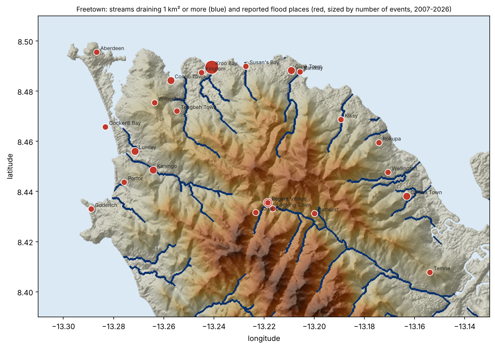

# Hindcast: does open data "see" Freetown's past floods?

*November 2026. First pass, daily resolution. Reproduce with `floodwatch fetch && floodwatch hindcast --from 2008 && floodwatch terrain`.*

*Updated 22 Nov 2026 after a second research round: the wettest days with no reported flood and the empty years were searched one by one. Seven dated floods were added; three of them fell on days this analysis had flagged as wet but unreported (14 Jul 2023, 28-29 Jul 2023, 27-28 Jul 2024). A third round searched Facebook, X and YouTube and added three street floods from 2022 (17 Jun, 9 Jul, 15 Aug), each confirmed in a dated news article. The research notes are in `data/events/research/`.*

## Questions

1. Were the days Freetown flooded unusually wet in freely available satellite rainfall?
2. Does the tide matter, especially for shoreline communities?
3. Where do floods happen relative to the terrain?
4. What does the flood history say about *how* warnings must be delivered?

## Data

| What | Source | Notes |
|---|---|---|
| Floods | `data/events/freetown_floods.csv`: 36 events, 2007-2026, 31 with a known day from 2008 on | Built from news, NDMA, IFRC/Red Cross, OCHA and social media in three research rounds. Thin before 2014; none found for 2011-2013, 2016 and 2018. Each row cites its sources. |
| Rain | CHIRPS v3 daily `sat` product, 0.05 deg (~5.5 km), 49 cells over the peninsula, April-November, 2008-2026 (19 rainy seasons). 2000-2007 is not scored: no dated floods were found before 2008, so those seasons would only add false alarms caused by gaps in the list. | 5-day station-corrected satellite totals, split across days with NASA IMERG. Good for "how wet was this day", no hour-level timing. |
| Tide | Harmonic tide fitted (UTide) to Open-Meteo modelled sea level 2023-2026 and predicted back to 2000 | Held-out year error 4.7 cm against a +/-68 cm signal. Main constituent M2 = 0.90 m, so spring range ~2.4 m, neap ~1.2 m. |
| Terrain | Copernicus 30 m elevation model | Streams, upstream area, height above nearest stream (HAND). |

## Method

- **Flood window.** Each flood with a known day *E* is matched to rain on *E-1, E, E+1*, because overnight floods are dated by the evening in some reports and by the morning after in others.
- **Rules.** "Warn when rain exceeds the *p*-th percentile of rainy-season days" for *p* = 90, 95, 97.5, 99, on several rain measures. Percentiles are fixed in advance, not tuned to the floods, so the scores are not flattered by fitting.
- **Scores.** *Hits* (floods with the rule firing in the window), *false alarms per season* (runs of firing days touching no known flood), and *AUC*: the probability a flood window is wetter than a random ordinary window (0.5 = no information, 1 = perfect).
- **Lower bound.** Many real floods never made the news, so some "false alarms" are probably unreported floods. True skill is higher than measured.

## Results

### 1. Free satellite rainfall does "see" most of Freetown's floods

Over 19 rainy seasons (2008-2026) and the 31 floods with a known day:

- **Flood days are much wetter than ordinary rainy-season days.** On the wettest cell, the median flood window had **93 mm**, against **37 mm** on ordinary days.
- **Rain separates flood days from ordinary days clearly, though not perfectly.** For peninsula-average rain on the day, the AUC is **0.82** (90% interval 0.75-0.89). 0.5 would mean no information.
- **Most big floods stand out.** On the wettest cell, 21 of the 31 flood windows were wetter than 85% of ordinary windows, and 13 were wetter than 95%. The deadliest stand out most: Regent, August 2017, was at the 96th percentile; 28 August 2022 at the 100th; 20 July 2024 at the 99th.

### 2. The misses have a pattern: the edges of the season

The weakest cases (wettest cell, percentile of ordinary days) are these:
- 4 May 2014: 74th percentile.
- 9 May 2023: 32nd percentile.
- 23 May 2026: 9th percentile.
- 24 October 2024: 47th percentile.
- 23 July 2025: an evening storm, 61st percentile.
- 31 July 2025: 71st percentile.
- 4 August 2024: a wall collapse at Calaba Town, 32nd percentile. The three days before it were very wet (89th percentile), so ground wetness, not the day's rain, explains it.
- 26 July 2021: the date itself is uncertain.

Four of the eight fall in May or October, the transition months. Two explanations fit, and both matter for the product:
- **The storms are short.** Early- and late-season storms are brief, intense convective downpours. Daily data spreads them across a whole day, and CHIRPS also spreads each 5-day total across days.
- **Less rain is needed to flood.** At the start of the season, drains are still blocked with dry-season rubbish, and slopes and walls have been dry and loose.

So transition months need their own, lower trigger, judged on **hourly** rain.

### 3. Rules from daily rain alone: useful, but noisy

| Rule (fires on...) | Floods caught | False alarms per season |
|---|---|---|
| That day + previous 3 days in the top 5% (>= 158 mm) | 16 of 31 | 3.1 |
| Peninsula-average rain in the top 2.5% of days (>= 75 mm) | 15 of 31 | 4.3 |
| Previous 3 days in the top 2.5% (>= 155 mm) | 6 of 31 | 2.1 |
| Wettest cell in the top 10% (>= 62 mm) | 22 of 31 | 15.6 |

A daily rule catching half the floods with about 3 false alarms per 7-month season is a reasonable **Outlook/Watch** level. It is not good enough for a street-level Warning on its own. That level needs hourly rain and resident confirmation (layer 4).

**Some of these "false alarms" are real floods that were never reported, and searching for them works.** The second research round searched the 15 wettest no-flood days. It found floods on three of them, and a rule's hits rose with no extra false alarms. A third round, on social media, found nothing on these dates; its three new floods were on other, less extreme days. The wettest day in the record still without a report is **16 August 2013**: 232 mm across the peninsula and 284 mm on the wettest cell. Online archives for 2011-2013, 2016 and 2018 are thin, so these dates need local sources: newspaper archives in Freetown, NDMA records, or residents. The updated list is below.

### 4. Tide: not yet detectable

- **Shoreline floods:** across the 10 floods in shoreline communities, tides were no higher than on ordinary days (AUC 0.52, interval 0.40-0.64).
- **Inland floods:** no tide effect, as expected (AUC 0.50).

Keep tide as an input for shoreline zones and re-test with more events and hourly timing. With daily data, a high tide anywhere in the 3-day window counts, which blurs the effect.

### Full tables

(Generated by `floodwatch hindcast --from 2008`; also in `data/derived/hindcast_tables.md`.)

Source: CHIRPS v3 daily (satellite + gauges, IMERG-timed). Period 2008-04-01 to 2026-10-08, 19 rainy seasons, 31 dated floods.

**How well each rain measure separates flood days from ordinary rainy-season days**

| Rain measure | AUC | 90% interval | Median on flood days | Median on other days |
|---|---|---|---|---|
| Wettest cell, that day | 0.81 | 0.73-0.88 | 93 mm | 37 mm |
| Peninsula average, that day | 0.82 | 0.75-0.89 | 67 mm | 22 mm |
| Peninsula average, previous 3 days | 0.79 | 0.71-0.85 | 104 mm | 45 mm |
| Peninsula average, previous 7 days | 0.76 | 0.67-0.84 | 213 mm | 95 mm |
| Peninsula average, that day + previous 3 days | 0.80 | 0.72-0.87 | 160 mm | 58 mm |

**Each flood: rain as a percentile of ordinary rainy-season days**

| Flood date | Wettest cell | Percentile | Peninsula avg + previous 3 days | Percentile |
|---|---|---|---|---|
| 2008-09-11 | 106 mm | 94 | 162 mm | 93 |
| 2009-08-13 | 93 mm | 90 | 187 mm | 96 |
| 2010-08-09 | 86 mm | 88 | 124 mm | 86 |
| 2014-05-04 | 59 mm | 74 | 40 mm | 33 |
| 2014-07-13 | 114 mm | 96 | 168 mm | 94 |
| 2014-09-05 | 80 mm | 86 | 80 mm | 66 |
| 2015-09-16 | 80 mm | 86 | 121 mm | 84 |
| 2017-08-14 | 119 mm | 96 | 185 mm | 95 |
| 2017-08-26 | 83 mm | 87 | 168 mm | 94 |
| 2019-08-02 | 114 mm | 96 | 198 mm | 97 |
| 2019-08-15 | 189 mm | 100 | 173 mm | 94 |
| 2020-07-14 | 104 mm | 93 | 170 mm | 94 |
| 2020-08-25 | 144 mm | 98 | 194 mm | 96 |
| 2021-07-26 | 29 mm | 38 | 91 mm | 72 |
| 2022-06-17 | 60 mm | 75 | 115 mm | 82 |
| 2022-07-09 | 84 mm | 87 | 88 mm | 70 |
| 2022-08-15 | 179 mm | 99 | 184 mm | 95 |
| 2022-08-17 | 179 mm | 99 | 244 mm | 99 |
| 2022-08-28 | 207 mm | 100 | 247 mm | 99 |
| 2023-05-09 | 24 mm | 32 | 34 mm | 26 |
| 2023-07-14 | 160 mm | 99 | 175 mm | 94 |
| 2023-07-28 | 202 mm | 100 | 255 mm | 99 |
| 2024-07-16 | 128 mm | 97 | 150 mm | 92 |
| 2024-07-20 | 181 mm | 100 | 308 mm | 100 |
| 2024-07-27 | 180 mm | 100 | 160 mm | 93 |
| 2024-08-04 | 24 mm | 32 | 136 mm | 89 |
| 2024-10-24 | 34 mm | 47 | 66 mm | 56 |
| 2025-07-23 | 46 mm | 62 | 60 mm | 51 |
| 2025-07-31 | 55 mm | 71 | 53 mm | 46 |
| 2026-05-23 | 8 mm | 9 | 11 mm | 8 |
| 2026-08-03 | 65 mm | 79 | 103 mm | 78 |

**Wettest days with no reported flood (first dates to search for missing floods)**

| Date | Peninsula average | Wettest cell | Previous 3 days |
|---|---|---|---|
| 2013-08-16 | 232 mm | 284 mm | 36 mm |
| 2008-08-23 | 165 mm | 213 mm | 10 mm |
| 2008-07-27 | 160 mm | 194 mm | 117 mm |
| 2012-07-29 | 159 mm | 200 mm | 122 mm |
| 2024-08-14 | 150 mm | 171 mm | 100 mm |
| 2010-08-22 | 147 mm | 234 mm | 67 mm |
| 2017-07-08 | 135 mm | 173 mm | 47 mm |
| 2015-05-18 | 134 mm | 160 mm | 12 mm |
| 2013-08-30 | 126 mm | 178 mm | 83 mm |
| 2025-08-07 | 122 mm | 146 mm | 75 mm |
| 2016-07-27 | 120 mm | 150 mm | 175 mm |
| 2018-07-22 | 119 mm | 179 mm | 40 mm |
| 2013-08-25 | 118 mm | 153 mm | 18 mm |
| 2016-09-17 | 116 mm | 172 mm | 100 mm |
| 2017-08-22 | 114 mm | 163 mm | 31 mm |

The full rule table (every measure at every threshold) is in `data/derived/hindcast_tables.md`.

### What this means for the product

1. **The open-data approach works for the Outlook and Watch levels.** Big floods are visible in free satellite rainfall without any sensor.
2. **Street-level Warnings need hourly rain and people.** Daily rain alone is too noisy. Hourly satellite rain (IMERG) and resident confirmation are the next two building blocks, not optional extras.
3. **Use season-aware triggers.** May and October floods happen at lower rain totals.
4. **Use separate triggers for the two kinds of flood place.** Stream mouths and shoreline need rain intensity plus tide. Hillsides need accumulated rain, for landslides and wall collapses (see the terrain section).
5. **Completing the flood memory is high-value, cheap work.** The unreported-wet-days list points exactly where to look.

## When floods happen: what it means for delivering warnings

- **Season:** 14 of the 36 floods were in August; July and September add 17 more.
- **Time of day:** of the 17 floods with a reported time, **13 hit at night or in the early hours** (e.g. 4 am Owen Street mudslide 2010, 05:45 Regent 2017, overnight 1-2 Aug 2019, the night-time Moyiba landslide of July 2024, overnight 2-3 Aug 2026).
- **Implication:** SMS alone will not wake people. Warnings need **voice calls** (a ringing phone) and **street wardens** with loudspeakers or whistles, as the concept proposes.

## Where floods happen: terrain

Of 75 place names in the flood history, 21 could be placed as neighbourhoods on OpenStreetMap; the rest are streets, landmarks or descriptions ("low-lying areas"). They fall into two distinct groups:

| Group | Places | Terrain | Mechanism |
|---|---|---|---|
| **Stream mouths and shoreline** | Kroo Bay (7 events), Susan's Bay, Kanikay, Cline Town, Portor, Lumley, Kaningo, Cockerill Bay | Under ~3 m above the nearest stream, on streams draining 1-13 km² | Streams overflow where they meet the sea; tide can block outflow |
| **Hillsides and upper valleys** | Regent, Looking Town, Sugar Loaf, Bathurst, Tengbeh Town, Wilberforce | 90-360 m elevation, steep | Runoff, landslides, wall collapses |

The two groups need different triggers: rain *intensity* plus tide for the first, *accumulated* rain over several days (soil saturation) for the second.

Limits: geocoded points are neighbourhood centres, not the flooded streets, and the elevation model includes roofs and trees and cannot see culverts. Street-level flood points from residents or partners would sharpen this a lot.

## Limitations

1. **Small, news-biased flood list.** 31 dated floods; small floods and quiet years are missing. Every score has wide uncertainty.
2. **Daily rain only.** CHIRPS cannot tell a 3-hour cloudburst from a steady all-day rain, which is exactly what matters for flash floods. It also smooths a 5-day total across days.
3. **Coarse rain grid vs. tiny catchments.** ~5.5 km cells, and the daily timing comes from ~10 km IMERG.
4. **Modelled tide only.** Fitted to a model's sea level, not a tide gauge; surge is ignored.

## Next steps

1. **Hourly rain** for the same floods: NASA IMERG half-hourly (needs a free NASA Earthdata account) and ECMWF 9 km via Open-Meteo once its quota allows. This answers the lead-time question.
2. **Grow the flood list**: local newspaper archives, NDMA releases, IFRC DREF reports, Freetown City Council, and interviews; add dated *non-flood* heavy-rain days.
3. **Street-level exposure**: building footprints plus resident-reported flood points; define warning zones per catchment.
4. **Separate triggers** for the two flood groups above, then re-score.
