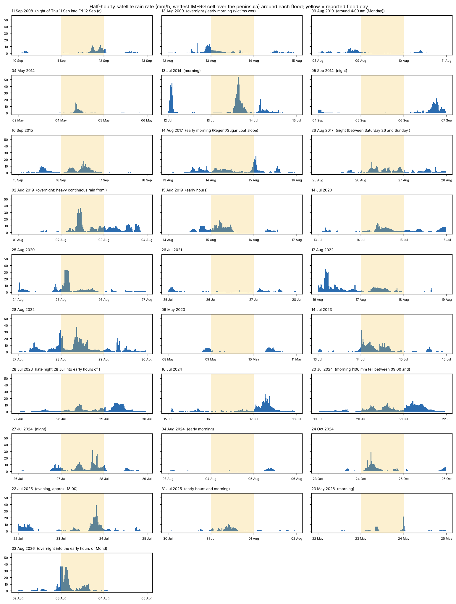

# Half-hourly rain around past floods (NASA IMERG) — v0

*November 2026. Reproduce with `floodwatch subdaily` (needs a NASA Earthdata token).*

The daily hindcast showed that flood days are wetter, but could not say *when*
the rain fell or how intense it was. This analysis uses NASA's IMERG V07
satellite rainfall: a rain rate every 30 minutes on a 0.1° (~11 km) grid. It
uses the 9 cells over the peninsula and the Final (gauge-corrected) run.

*Half-hourly rain rate on the wettest cell, over three days around each of the 21 dated floods (2008-2026). The yellow band is the reported flood day.*

## 1. Timing: how long before a flood does the heavy rain fall?

For the 11 floods whose reports give a time of day, I measured the rain on the wettest cell in the 12 hours before that time. Vague phrases were turned into times, with the assumption recorded in `subdaily.REPORTED_TIMES`; for example, "early hours" became 03:00.

| Flood | Reported time | Rain in previous 3 h | 6 h | 12 h | Heavy rain (>= 10 mm/h) began | Hours before report |
|---|---|---|---|---|---|---|
| 11 Sep 2008 | ~midnight | 25 mm | 39 mm | 56 mm | 17:30 | 6.5 |
| 13 Aug 2009 | ~03:00 | 13 mm | 46 mm | 64 mm | 16:00 (day before) | 11.0 |
| 9 Aug 2010 (mudslide) | ~04:00 | 2 mm | 10 mm | 38 mm | not reached | - |
| 14 Aug 2017 (Regent) | 05:45 | 14 mm | 26 mm | 50 mm | not reached | - |
| 26-27 Aug 2017 | ~midnight | 16 mm | 25 mm | 52 mm | not reached | - |
| 2 Aug 2019 | ~07:00 | 14 mm | 16 mm | 20 mm | not reached | - |
| 15 Aug 2019 | ~03:00 | 21 mm | 34 mm | 66 mm | 02:00 | 1.0 |
| 20 Jul 2024 | 12:00 | 7 mm | 24 mm | 50 mm | not reached | - |
| 23 Jul 2025 | ~18:00 | 23 mm | 24 mm | 38 mm | 16:30 | 1.5 |
| 23 May 2026 | ~09:00 | 7 mm | 10 mm | 11 mm | not reached | - |
| 3 Aug 2026 | ~04:00 | 79 mm | 143 mm | 149 mm | 23:30 | 4.5 |

What this shows:
- **The median flood had about 50 mm on the wettest cell in the 12 hours before it was reported.**
- **Where a clear burst exists, it starts 1 to 11 hours before the flood is reported,** most often 1-6 hours.
- **The two deadly mudslides (Owen Street 2010, Regent 2017) had no single burst.** They followed long wet spells: Regent came after three days of heavy rain. Accumulated-rain triggers fit them, not intensity triggers.
- **Satellite intensity under-reads local cloudbursts badly.** On 20 July 2024 the Tower Hill rain gauge recorded 106 mm between 09:00 and 12:00. IMERG shows under 7 mm on its wettest cell in those hours and places the heavy rain at 06:00-08:00 and 12:00-15:00. A satellite cell is about 11 km wide and its rain is estimated from snapshots, so short local downpours are smeared and shifted. Any satellite threshold must be set on the satellite's own scale (percentiles), never compared directly with gauge millimetres.

## 2. Some daily "misses" were short bursts

Two floods that looked ordinary in daily rain stand out half-hourly:
- **24 Oct 2024:** CHIRPS daily put it at the 47th percentile. IMERG shows **22 mm in one hour and 40 mm in three** on the morning of the flood.
- **23 Jul 2025:** daily percentile 61. IMERG shows **29 mm in one hour and 59 mm in three**, from 18:00, matching the reported evening flood.

The **May floods stay weak even half-hourly**:

| Flood | Most in 1 h | Most in 3 h |
|---|---|---|
| 4 May 2014 | 14 mm | 23 mm |
| 9 May 2023 | 7 mm | 15 mm |
| 23 May 2026 | 14 mm | 16 mm |

Either these early-season events (a boulder fall, a wall collapse, a localised flood) need much less rain because drains and slopes are in their dry-season state, or the rain was too local for any satellite. Either way, May needs its own lower trigger, and ground reports.

## 3. Comparison with very wet days that did not flood

*In progress.* This section will compare 1-6 hour maxima on flood windows with two groups:
- 30 of the wettest rainy-season days with no reported flood.
- 30 ordinary rainy-season days.

It will use the same three-day windows. Results follow when the download completes.

## What this means for the product

1. **There is little time to warn from observed rain.** The heavy rain usually falls in the 1-6 hours before a flood. IMERG's quickest version arrives about 4 hours late, so it can *confirm* and *learn*, but cannot be the real-time trigger.
2. **The real-time Warning level needs faster signals:**
   - Storm tracking from geostationary satellite imagery (every 10-15 minutes) and lightning from the MTG Lightning Imager. These see storms forming before the rain peaks.
   - Phone-network rain data, once a partner shares it.
   - Residents' reports.
3. **The Watch/Outlook level comes from forecasts and wetness.** Accumulated rain over several days is what preceded the deadly mudslides, and that is visible a day or more ahead.
