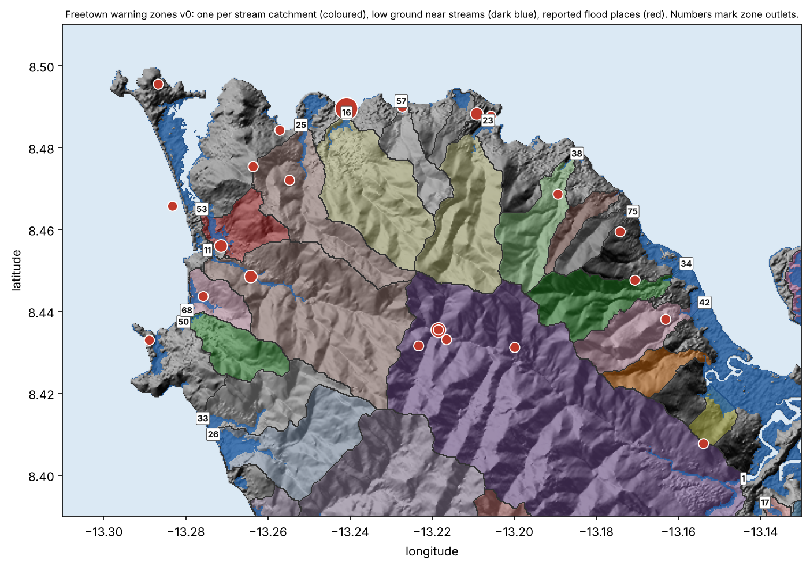

# Warning zones v0

*November 2026. Reproduce with `floodwatch terrain && floodwatch zones`.*

A flash flood is a catchment-scale event: rain anywhere upstream arrives at the
same outlet, usually within the hour. So the unit for a warning is the
**catchment**. Each stream catchment that drains at least 1 km² to the sea or the
estuary becomes a zone. They are traced from the Copernicus 30 m elevation
model.

## What came out

- **94 zones** cover the peninsula, **21** of them with outlets in the city.
- The rest of the land is **zone 0, the "coastal fringe"**: short slopes that drain straight to the sea, and the flat eastern lowlands and mangroves.
- **11 zones** contain a place named in the flood history.

| Zone | Name | Area | Low ground near streams | Steep share | Flood places in it |
|---|---|---|---|---|---|
| 16 | Kroo Bay | 7.6 km² | 0.11 km² | 7% | Kroo Bay (7 events) |
| 11 | Kaningo | 13.6 km² | 0.21 km² | 18% | Kaningo, Lumley |
| 23 | Cline Town | 6.6 km² | 0.06 km² | 13% | Cline Town, Kanikay |
| 25 | Tengbeh Town | 6.2 km² | 0.14 km² | 2% | Tengbeh Town, Wilberforce |
| 1 | Bathurst | 47.1 km² | 0.33 km² | 19% | Regent, Sugar Loaf, Looking Town, Bathurst |
| 57 | Susan's Bay | 2.2 km² | 0.02 km² | 5% | Susan's Bay |
| 68 | Portor | 1.7 km² | 0.21 km² | 1% | Portor |
| 34, 38, 75 | Wellington, Kissy, Rokupa | 1.5-4.1 km² | small | 9-11% | one each |

The full list, with outlets and all measures, is in `data/derived/zones.csv`. Zone outlines are in `data/derived/zones.geojson`.

Reading the map:
- **Kroo Bay**, the most-flooded place in the history, sits at the outlet of a 7.6 km² catchment that rises to nearly 600 m. Everything that falls on that hillside reaches the bay.
- **The hillside places** (Regent, Sugar Loaf, Looking Town) sit on the ridge between the big south-eastern basin (zone 1) and Kaningo (zone 11). The 2017 Regent mudslide actually ran down the Kaningo side. That is a reminder that neighbourhood-centre coordinates are too coarse for hillside places.

## Does zone-level rain help with today's data? Not yet

For each flood and each zone holding a place named in it, I compared two rain measures over the flood window. Each was ranked against its own rainy-season days:
- **That zone's own CHIRPS rain** (area-weighted cells, from `zone_chirps_weights.csv`).
- **The peninsula average.**

| | Mean percentile on flood days |
|---|---|
| Zone's own rain | 89.6 |
| Peninsula average | 88.7 |

Zone rain was higher in 14 of 22 pairs, but only by about one percentile point: no real gain. This is expected, because CHIRPS takes its daily timing from ~10 km IMERG pixels and the whole peninsula is one or two of them. Big floods are also peninsula-wide storms: on 28 August 2022 places in six zones flooded at once. Details are in `data/derived/zone_resolution_check.json`.

## What zones are for, then

1. **Who to warn.** A warning goes to the low ground of the zones at risk, not to the whole city.
2. **Triggers by type of ground.**
   - Zones with much low ground near the outlet (Kroo Bay, Portor, Kaningo/Lumley, Cline Town) get **intensity plus tide** triggers.
   - Zones with steep upper slopes (Bathurst/Regent, Kaningo, Cline Town) get **accumulated-rain** triggers for landslides and wall collapses.
3. **Where finer data pays off.** Hourly satellite rain, phone-network rain data and resident reports can all be summed per zone. That is where zone-level skill will come from.

## Who lives there

`floodwatch exposure` counts buildings and people per zone and per type of ground:
- **Buildings:** Overture Maps footprints, which merge Google, Microsoft and OpenStreetMap; 474,000 on the peninsula.
- **People:** Meta's 30 m High Resolution Settlement Layer; about 1.71 million on the peninsula.

| | People | Buildings |
|---|---|---|
| Whole peninsula | ~1,712,000 | ~474,000 |
| On low ground near streams or the shore (height above stream < 3 m, elevation < 20 m) | ~72,600 | ~23,300 |
| On steep slopes (> 25°) | ~44,200 | - |
| ...of which in the 21 city zones: low ground / steep | ~28,900 / ~37,500 | ~6,000 on low ground |

Each zone's numbers are in `data/derived/zones.csv`, the map popups and the Outlook's action lines. City zones with the most people on low ground:

| Zone | People in zone | On low ground | Buildings on low ground | On steep slopes | Flood-history mentions |
|---|---|---|---|---|---|
| 53 New Life Community (Lumley) | 55,600 | 4,900 | 700 | 100 | 0 |
| 11 Kaningo | 128,500 | 4,200 | 290 | 4,900 | 4 |
| 25 Tengbeh Town | 103,700 | 3,300 | 900 | 1,400 | 2 |
| 93 Cline Town (east) | 20,500 | 3,200 | 200 | 600 | 0 |
| 16 Kroo Bay | 153,200 | 2,800 | 1,100 | 9,800 | 7 |
| 68 Portor | 29,000 | 2,500 | 400 | 0 | 1 |
| 23 Cline Town | 52,400 | 900 | 400 | 11,800 | 3 |

**Treat these as lower bounds for low ground.** The elevation model measures the tops of roofs, so dense informal settlements on the flats look higher than the ground they stand on. Kroo Bay itself is home to several thousand people on land that floods, more than the 2,800 counted. Steep-slope counts are steadier. Zones with many people on low ground but no flood-history mentions (New Life Community, eastern Cline Town) are where to check first for unreported floods.

## Limitations

- **The model sees roofs, not drains.** The elevation model is a surface model (roofs and trees) and cannot see culverts or drains, so urban flow paths are approximate.
- **Neighbourhood points are coarse.** Flood places are neighbourhood centres; street-level points (from residents or partners) would place floods in the right zone with confidence.
- **No buildings yet.** Low ground is measured as land area, not homes. Building footprints are the next layer, but the OpenStreetMap API was blocked from this environment.
